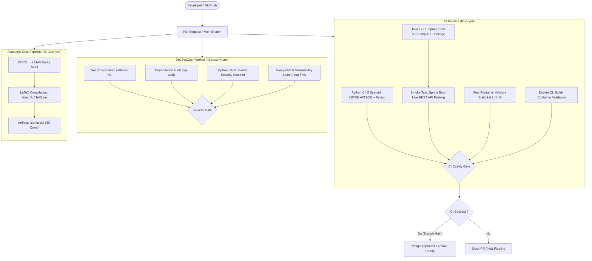

# Impactul tehnologiilor inteligente asupra securitatii digitale
## Proiect de Licență & Suită de Securitate Cibernetică (FEAA Craiova 2027)

**Universitatea din Craiova** | **Facultatea de Economie și Administrarea Afacerilor (FEAA)**  
**Program de Studii:** Informatică Economică (Promoția 2027)  
**Absolvent:** Moană Ștefănuț-Cornel  
**Coordonator Științific:** Prof. univ. dr. Georgeta Soavă  

---

## Tema Licență — FINAL

* **Titlu:** Impactul tehnologiilor inteligente asupra securitatii digitale
* **Coordonator:** prof. univ. dr. Georgeta Soava
* **Inventariere stack:** Lucrare de licență — Inventar inițial

### Tech Stack
Windows Server, Linux, networking TCP/IP, wire shark, tcpdump, SIEMuri precum Splunk, Elastic, Wazuh sau Sentinel, EDR, IDS/IPS, nmap, nessus, openVAS, burp, powershell, python, git, mașini virtuale, sysmon, sigma, yara, snort, MISP, malware autopsy, volatility, ghidra, IDA sau x64dbg, directiva NIS2, MITRE ATT&CK pentru cartografierea atacurilor, Ansible, Python și Terraform pentru IaC, automatizând izolarea VM-urilor compromise în urma alertelor din SIEM, Kubernetes, AWS.

### Practici, simulări și exemple
* Red-teaming ușor (bruteforce, hacking etic pe mașina mea virtuală personală).
* Honeypot pe un OS vechi (Windows Server 2003/2008 sau Windows 7).
* Simularea unui mediu bancar (sisteme Windows 10/11 + Active Directory).
* Analiza malware pe un Windows 10 pregătit pentru așa ceva.
* POSIBIL - Vulnerabilitatea rețelelor Wi-Fi (social engineering sau handshaking WPA2/WPA3 cu ESP32 Bruce/Marauder).
* Detecția și monitorizarea wireless a acestuia în SOC.
* Analiza riscului împotriva Wi-Fi sniffing.
* Simulare de atacuri bazate pe comportamentele reale ale grupurilor APT.
* Reverse engineering (IDA, Ghidra, x64dbg) pe software

> **Mențiune:** Între VM-urile mele, niciun atac nu va părăsi mașinile mele virtuale; lucrarea de licență va fi efectuată într-un cadru legal.

---

## 1. Prezentare Generală

Aici se află codul sursă, simulările practice și documentația pentru lucrarea de licență.

Proiectul conține un laborator de testare a rezilienței bancare conectat la un SIEM (Wazuh), segmentat pe mașini virtuale în Proxmox VE și protejat prin reguli de firewall L3 (OPNsense):
1. **VM 310 (Core-Banking Engine):** Motor contabil în partidă dublă (*Debite = Credite*) cu registru tranzacțional securizat prin lanț de hash-uri SHA-256.
2. **VM 311 (Bază de date financiară & Wazuh):** Bază de date relațională (ACID) și agent Wazuh configurat să detecteze tentative de SQL Injection și modificări neautorizate de sold (*Balance Tampering*).
3. **CT 312 (Payment Gateway & SWIFT):** Serviciu FastAPI pentru validarea plăților cu cardul (Luhn Mod 10, mascare PAN, protecție anti-flood) și mesagerie interbancară pe standardul SWIFT / ISO 20022 (`pacs.008`).
4. **VM 313 (Bastion Jump-Box):** Punct de acces administrativ prin SSH (chei Ed25519 și autentificare MFA).
5. **Web Banking Kiosk:** Terminal web de casierie/ATM (Vanilla JS + Spring Boot 3.2 pe Java 17) cu telemetrie JSON trimisă direct către Wazuh.

---

## 2. Arhitectură CI/CD & DevSecOps

Pipeline-urile din GitHub Actions testează automat codul și compilează documentația LaTeX la fiecare push pe ramura `main` sau deschidere de pull request. Sunt configurate filtre de cale (`path filters`) pe `licenta/LL3-LucrareLicenta/**`, astfel încât workflow-urile să nu ruleze dacă se modifică alte proiecte din repozitoriu.

### 2.1. Diagrama Arhitecturală a Pipeline-ului



### 2.2. Structura Workflow-urilor GitHub Actions

| Workflow | Fișier | Responsabilitate & Porți de Calitate | Triggere |
| :--- | :--- | :--- | :--- |
| **Continuous Integration** | `.github/workflows/ci.yml` | Validare bytecode Python, 5 scenarii MITRE ATT&CK, compilare Maven Java 17, build Docker, smoke test REST live. | `push`, `pull_request`, `workflow_dispatch` |
| **DevSecOps & Security** | `.github/workflows/security.yml` | Scanare secrete Gitleaks, auditare dependențe `pip-audit`, analiză statică SAST Bandit, scanare Trivy. | `push`, `pull_request`, `workflow_dispatch` |
| **Academic Documentation** | `.github/workflows/latex.yml` | Verificare paritate DOCX ↔ LaTeX, compilare TeXLive în PDF și generare artefact `licenta-pdf`. | `push`, `pull_request`, `workflow_dispatch` |

### 2.3. Politica de Securitate și Porți Blocante (Quality Gates)

* **Blocante (Pipeline Failure):**
  * Secrete sau credențiale detectate în commit de Gitleaks.
  * Eșec la oricare dintre cele 5 scenarii de atac bancar MITRE ATT&CK.
  * Eșec la compilarea Java/Maven sau testele unitare Spring Boot.
  * Legături sau fișiere lipsă în interfața statică a terminalului Kiosk.
  * Eșec la build-ul imaginii Docker sau la testul de integrare live REST API.
  * Erori fatale de sintaxă la compilarea documentului academic LaTeX.
* **Avertismente (Informational / Warnings):**
  * Vulnerabilități moderate în dependențe de laborator semnalate de `pip-audit`.
  * Recomandări non-critice de stil sau formatare SAST emise de `bandit`.

---

## 3. Documentație Academică (DOCX & LaTeX)

Documentația este disponibilă atât în format Microsoft Word (`.docx`), cât și ca proiect modular LaTeX (`.tex` / `.bib`), permițând versionarea completă a textului în Git și generarea automată a PDF-ului prin CI/CD.

### 3.1. Structura Fișierelor Academice

```
licenta/LL3-LucrareLicenta/
├── LUCRARE LICENTA - 31.08.2026.docx     # Documentul Word original de referință
├── LUCRARE LICENTA - 31.08.2026/         # Structură LaTeX asociată versiunii
└── latex/                                # Structura LaTeX modulară principală
    ├── main.tex                          # Fișierul master de asamblare și formatare
    ├── preamble.tex                      # Pachete tipografice, margini A4, stiluri
    ├── metadata.tex                      # Titlu, autor, coordonator, instituție
    ├── chapters/
    │   ├── 00_introducere.tex            # Introducere, motivație și obiective cercetare
    │   ├── 01_stadiul_cunoasterii.tex    # Capitolul 1: Normative, PSD2, DORA, PCI-DSS, atacuri
    │   ├── 02_proiectare_si_implementare.tex # Capitolul 2: Topologie virtuală, VM-uri, simulări
    │   └── 03_concluzii.tex              # Concluzii, contribuții originale și direcții viitoare
    ├── bibliography/
    │   └── references.bib                # Cele 35 de referințe bibliografice în format BibTeX
    └── appendices/
        └── anexe.tex                     # Anexele A, B, C (Scheme SQL DDL, Python, JSON Wazuh)
```

### 3.2. Automatizare și Verificare Paritate (DOCX ↔ LaTeX)

Pentru a menține corespondența bijectivă între orice versiune DOCX și sursele LaTeX, a fost dezvoltat utilitarul:
```bash
# Extragere și sincronizare automată a conținutului din DOCX în LaTeX
python3 scripts/sync_academic_docs.py --sync

# Verificare paritate și raportare integritate academică
python3 scripts/sync_academic_docs.py --verify
```

În GitHub Actions, workflow-ul `ll3-docs.yml` compilează automat `main.tex` utilizând distribuția TeXLive (`xu-cheng/latex-action@v3`) și salvează documentul rezultat sub denumirea `LUCRARE_LICENTA_2027.pdf` ca artefact cu retenție de 30 de zile.

---

## 4. Recomandări Branch Protection & Setări GitHub

Pentru a proteja ramura `main` și a preveni regresii accidentale, se recomandă activarea următoarelor reguli în setările depozitului:

1. **Branch Protection Rule pe `main`:**
   * **Require a pull request before merging:** Activ (minimum 1 review).
   * **Require status checks to pass before merging:**
     * `CI Quality Gate Aggregate` (din `ll3-ci.yml`)
     * `DevSecOps Gate Aggregate` (din `ll3-security.yml`)
     * `Validate Parity & Compile LaTeX PDF` (din `ll3-docs.yml`)
   * **Require branches to be up to date before merging:** Activ.
   * **Do not allow bypassing the above settings:** Activ.

